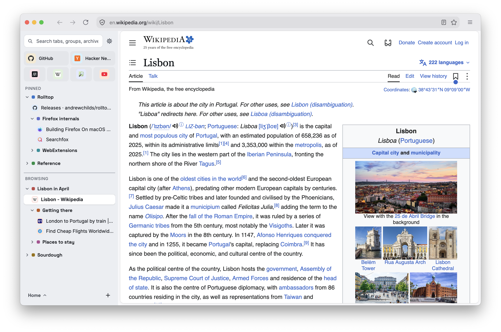
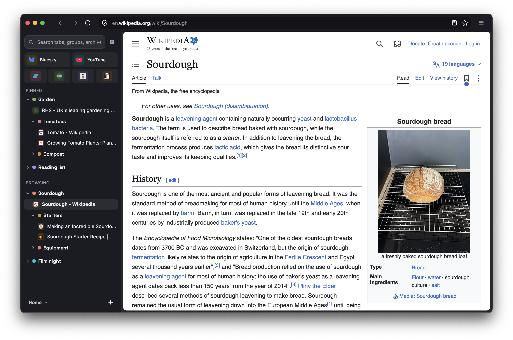

<h1> Rolltop</h1>

Rolltop is a minimalist web browser for macOS, built as a small fork of Firefox ESR. It replaces the tab strip with a sidebar that automatically groups, labels and archives your tabs for you.

The tabs sidebar is split into three sections: favorites, pinned, and browsing.

Rolltop in light mode:



Rolltop in dark mode:



## Download

Get the latest signed and notarized build from the [releases page](https://github.com/andrewchilds/rolltop-browser/releases/latest). Open the DMG and drag Rolltop to Applications.

Builds are for Apple silicon Macs.

## What is different from Firefox

* No tab strip. The Rolltop sidebar lists your tabs in groups, with workspaces, pinned tabs and an archive.
* Tabs are grouped by website. With your own Anthropic API key, Rolltop asks Claude to group them by what you are doing instead. The request goes straight from the browser to Anthropic; without a key nothing leaves your computer. Tabs in private windows are never sorted.
* Telemetry, studies, crash reports, sponsored content, onboarding, Firefox accounts and Sync are turned off.
* uBlock Origin is installed into new profiles.
* The previous session's windows and tabs are restored on startup.

Rolltop keeps its profile in `~/Library/Application Support/Rolltop`, separate from any Firefox install.

## Known limitations

* There is no automatic updater yet. New builds are published on the releases page.
* Passkeys stored in iCloud Keychain or a password manager are not available yet. Hardware security keys work.

## Building

Rolltop builds like Firefox. See the [Firefox Source Docs](https://firefox-source-docs.mozilla.org/) for prerequisites, then create a `mozconfig` at the top of the tree:

```
. "$topsrcdir/rolltop/mozconfig-release"
ac_add_options --enable-bootstrap
```

and run `./mach build`, followed by `./mach package` for a DMG. For front-end work, source `rolltop/mozconfig` and add `ac_add_options --enable-artifact-builds` to skip compiling C++ and Rust.

## License

Rolltop's source is available under the [Mozilla Public License 2.0](./LICENSE), like the Firefox code it is built on.

Rolltop is not affiliated with or endorsed by Mozilla. Firefox is a trademark of the Mozilla Foundation.
